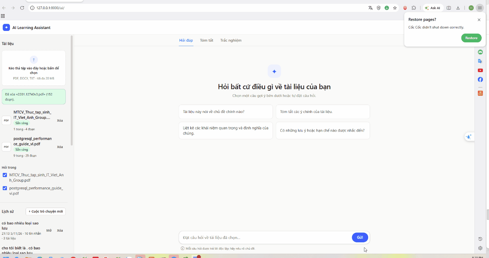

# AI Learning Assistant (RAG)

Document Q&A app: users upload PDF/DOCX/TXT, ask questions, get answers grounded in the documents with source citations. Also summary and quiz generation.

## Context
- Owner is a final-year IT student building a portfolio project for AI Engineer interviews. They must understand and be able to defend every part.
- Deadline: ~2 days total. Normal laptop, no GPU. Prefer cloud APIs, free tiers.
- Reply to the user in Vietnamese. Code, comments, identifiers, commit messages in English.

## Stack and decisions
- Python 3.11/3.12, FastAPI, Pydantic v2, Streamlit, pytest.
- LLM: Gemini via the `google-genai` SDK. NEVER use the deprecated `google-generativeai` package.
- Embeddings: Gemini embedding API by default (BGE-M3 on CPU is too slow/heavy). Keep it behind an interface in `embeddings.py` so it can be swapped.
- Vector DB: Qdrant (Docker). SQLite via stdlib `sqlite3` for metadata and chat history (no ORM).
- NO LangChain in the core pipeline (at most `langchain-text-splitters`). The pipeline is hand-written so it can be explained.
- PDF: PyMuPDF. DOCX: python-docx.
- Model names and embedding dimension come from `.env`, never hardcoded. Verify model names with a real API call before relying on them; they change often.
- Pin package versions in requirements.txt only after checking they install together.

## Architecture
Indexing: upload -> validate -> extract (keep page numbers) -> clean -> chunk -> embed (batch) -> upsert to Qdrant.
Query: question -> embed query -> top-k search (filtered by document/collection) -> score threshold -> build context -> prompt -> Gemini -> answer + citations.
- Chunk ID = uuid5 of (file content hash + chunk index) so re-uploading the same file never duplicates vectors.
- Payload per chunk: doc_id, filename, page, chunk_index, text.
- If no chunk passes the threshold, return a clear "insufficient evidence" fallback WITHOUT calling the LLM.
Summary and quiz (`app/summary.py`, `app/quiz.py`): read the document's chunks from Qdrant (`get_chunks`), ONE LLM call when it fits (map-reduce with a hard cap otherwise); quiz questions are validated and grounded in code (verbatim quote check, code-side option shuffle) with an optional verifier call. Every result is stored in SQLite (`generations`, keyed by text + params + model + prompt version) so a repeat costs 0 LLM calls.
Conversation history (FR-10): `POST /chat` saves every exchange (question + answer + sources + flags) in SQLite in ONE transaction (`Database.save_exchange`); a save failure never loses the answer (`saved: false`). `GET|DELETE /conversations`; opening a saved conversation makes no LLM call. Earlier messages are NOT used to understand follow-up questions (out of scope; the UI says so). No auth: history is shared (KI-29).
- RAG prompt must: answer only from supplied context, never invent document facts, say when context is insufficient, separate document evidence from general knowledge, cite chunk sources.

## Commands (update as they become real)
- venv: `python -m venv .venv && source .venv/bin/activate`
- Qdrant: `docker compose up -d`
- API: `uvicorn app.main:app --reload`
- UI: `streamlit run frontend/streamlit_app.py` (from the project root; `.streamlit/config.toml` makes it listen on 127.0.0.1 only; `API_BASE_URL` defaults to http://127.0.0.1:8000, `UPLOAD_MAX_MB` to 20 and must equal the backend's `MAX_UPLOAD_MB`)
- Tests: `pytest -q`
- Evaluation (real API calls, cached in `evaluation/cache/`): `python evaluation/evaluate.py` (`--skip-llm` retrieval only, `--report-only` rebuild the report)

## Priorities
P0: ingestion, embedding, retrieval, RAG chat, citations.
P1: FastAPI, Streamlit, error handling, evaluation.
P2: summary, quiz, history, Docker polish.
Finish P0 and P1 before any P2. If time runs short, cut Dockerfile for the app, then history, then quiz. Never cut evaluation.

## Working rules
1. Inspect existing files before changing anything. Never overwrite work you do not understand.
2. One module at a time. Test it before starting the next.
3. Do not create files that are not needed. No speculative abstractions.
4. Never claim something works unless you ran it. Report failures honestly.
5. Never print or commit secrets. `.env` is git-ignored.
6. Do NOT git commit unless the user explicitly asks.
7. Type hints on core functions. Use `logging`, not `print`. Catch specific exceptions.
8. Security: validate extension AND size AND real content of uploads; sanitize filenames; store under data/uploads with generated names.

## Mentoring format
After each major module, briefly cover: problem solved, why this design, how it works, key functions, what to know for an interview, tests to run, limitations. When modifying code, state which files changed, what, why, and how to test. Do not dump large code without explanation.

## Evaluation (evaluation/)
- At least 20 questions: answer in one chunk, answer across multiple chunks, insufficient evidence, unrelated to documents.
- Metrics: Precision@K, Recall@K (where labels exist), answer correctness, faithfulness, latency.
- Results must come from real runs. NEVER fabricate scores. Write them to evaluation/report.md.

## Known pitfalls
- Gemini free tier is rate limited: batch embeddings, add retry with backoff.
- Scanned PDFs have no text layer: detect and return a clear error (no OCR).
- Embedding model and dimension for indexing and querying must be identical; changing them requires re-indexing (recreate collection).
- Keep qdrant-client version compatible with the Qdrant server image.
