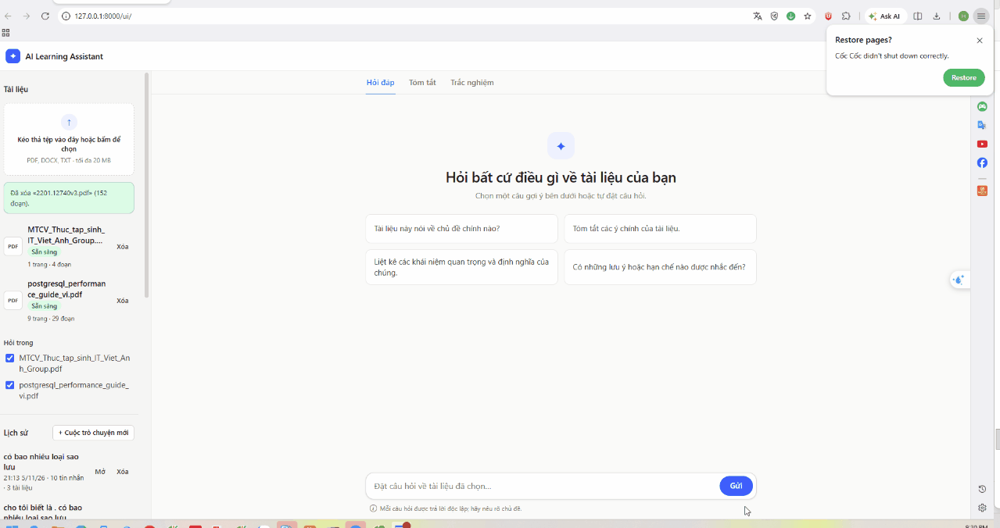
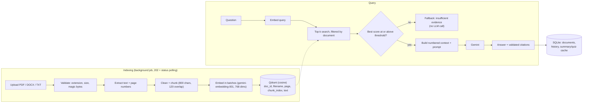
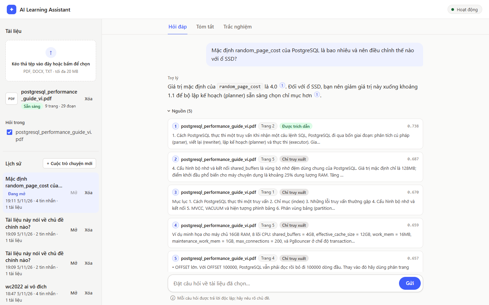
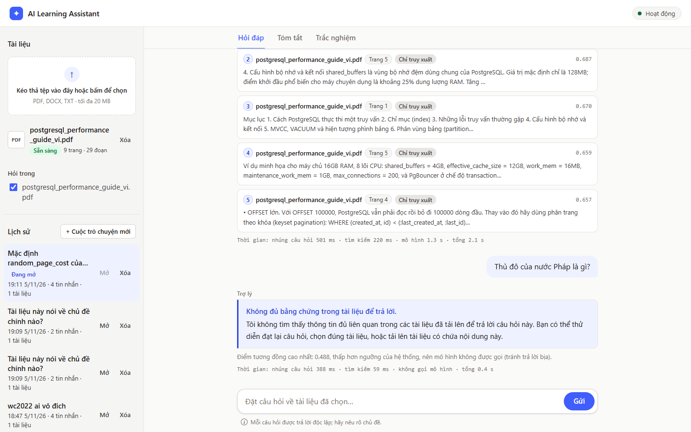
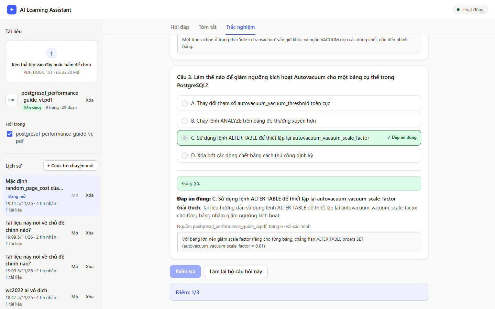
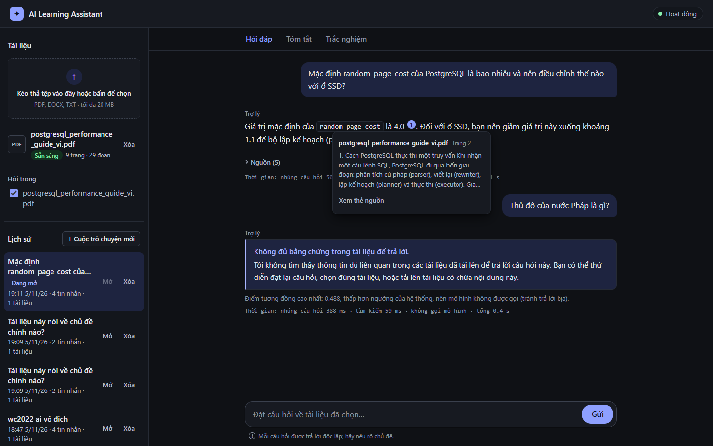

# AI Learning Assistant

**Upload a PDF, DOCX or TXT, ask questions in natural language, and get answers grounded in your document with page-level citations. When the document does not contain the answer, it says so instead of guessing.**

[](https://github.com/huyhoccode452/ai-learning-assistant/actions/workflows/tests.yml)
[](requirements.txt)
[](app/main.py)
[](docker-compose.yml)

> **Live demo:** _add link here_



## Highlights

1. **Retrieval that was measured, not assumed.** On a 20-question evaluation set (single-chunk, multi-chunk, insufficient-evidence and unrelated questions) the retriever reaches **Hit@5 = 1.000, MRR = 1.000, Recall@5 = 0.978** on the 15 answerable questions. Median end-to-end latency is **1.6 s**. Everything is in [`evaluation/report.md`](evaluation/report.md), produced by real API calls.
2. **It refuses instead of hallucinating.** If no chunk passes the similarity threshold (0.65), the app returns an "insufficient evidence" answer **without calling the LLM** (median 0.3 s). All **5/5** unanswerable questions were handled correctly (2 by the threshold, 3 by the model's own refusal), and the judge found **18/18** answers faithful to the retrieved chunks. Citation numbers that do not match a real source are stripped in code.
3. **Tested: 1,189 passing tests** (`pytest -q`; 29 more need a running Qdrant and are skipped otherwise). Gemini and Qdrant are faked, so the suite runs offline.
4. **Security checked in code and tests.** Uploads are validated by extension, magic bytes and size (default 20 MB, enforced by a middleware **before** the body is stored); files are saved under generated names. The web UI ships a strict CSP and has zero HTML-injection sinks, enforced by tests (see [Technical decisions](#technical-decisions)).
5. **Hand-written pipeline, no LangChain chains.** Extract → clean → chunk (800 chars, 120 overlap) → embed (`gemini-embedding-001`, 768 dims, batches of up to 100) → Qdrant → search → prompt → citations is plain Python. Indexing is idempotent (chunk ID = `uuid5(file hash + chunk index)`), and summaries and quizzes are cached in SQLite so a repeat costs **0 LLM calls**.

> **Read the numbers with care:** they come from one 9-page Vietnamese PDF (29 chunks) and 20 questions; the threshold was tuned on some of the same questions, labels are page-level, and the judge is an LLM (the same model that answered). Details and caveats: section 10 of the report and [`docs/known_issues.md`](docs/known_issues.md) (KI-26).

## Features

- **Chat with citations:** top-k search over the selected documents, answer with `[n]` markers; click a marker to see the file, page and excerpt.
- **Summary:** short or detailed. One LLM call when the document fits in 60,000 characters, bounded map-reduce otherwise.
- **Quiz:** multiple choice. Each question must carry a quote that really occurs in the cited chunk (checked in code); options are shuffled in code; an optional second call verifies the key.
- **Saved history:** every exchange is stored in SQLite; opening a saved conversation makes no LLM call.
- **Two UIs on the same API:** a plain HTML/CSS/JS web UI at `/ui/` (dark mode, phone layout) and a Streamlit app.

## Architecture



| Layer | Files |
|---|---|
| Typed configuration (`.env`) | `app/config.py` |
| Validation, extraction, cleaning, chunking | `app/ingestion.py` |
| Embeddings behind an interface (swappable) | `app/embeddings.py` |
| Vector store | `app/vectorstore.py` |
| RAG pipeline, threshold, citation check | `app/rag.py`, `app/prompts.py`, `app/generation.py` |
| Summary, quiz | `app/summary.py`, `app/quiz.py` |
| Metadata, history, generation cache (stdlib `sqlite3`, no ORM) | `app/db.py` |
| REST API | `app/main.py` |
| Web UI / Streamlit UI | `web/`, `frontend/` |
| Evaluation | `evaluation/` |

## Screenshots

| Answer with citations and sources | Insufficient evidence (no LLM call) |
|---|---|
|  |  |

| Quiz with answer key and source quote | Dark mode with citation popover |
|---|---|
|  |  |

More images (phone layout, summary, Streamlit app, XSS test) are in [`docs/screenshots/`](docs/screenshots/).

## Technical decisions

### Why Qdrant

- **Filtering by document.** Every chunk carries `doc_id` in its payload (with a payload index), so a question can be limited to the documents the user selected, and deleting a document is a filter delete. This is a core requirement of the app, not an extra.
- **Reading a whole document back.** Summary and quiz read all chunks of one document through the same store (scroll by `doc_id`), so one database serves both search and generation.
- **Idempotent writes.** Point IDs are deterministic (`uuid5`), so re-uploading the same file overwrites instead of duplicating. Before each upsert, the old points of that `doc_id` are deleted, so a smaller chunk count leaves no stale chunks.
- **Simple to run and to explain.** One Docker image, data in a named volume, a pinned server version (`qdrant/qdrant:v1.19.2`) aligned with the client (`qdrant-client==1.19.1`). The embedding model and dimension must be identical at index and query time, so changing them means recreating the collection; this is documented rather than hidden.

This is a design argument for this project's size (single user, one machine), not a benchmark against other vector databases; no such comparison was run.

### Why a hand-written Markdown renderer

The model's answer is not trusted text: it is generated from uploaded documents that may contain injected instructions (the prompt wraps chunks in nonce-marked "untrusted data" blocks, but that is a mitigation, not a guarantee). The usual route (a Markdown library that returns an HTML string, then a sanitizer) adds dependencies, needs a CDN or a build step, and keeps one forgotten sanitizer call away from an XSS bug.

`web/markdown.js` (about 450 lines, no dependencies) does the opposite: it builds the answer **only** with `createElement`, `createTextNode` and `appendChild`. It can only produce `p`, `br`, `ul`, `ol`, `li`, `h4`, `pre`, `code`, `strong` and `em`, and the only attribute it sets is a constant class name. Links, images and tables are not supported on purpose. The `[n]` markers are turned into citation elements by a callback from the app. The cost is a small Markdown subset (KI-30), which is enough for study answers.

### XSS and CSP

- **No injection sinks.** `tests/test_web_ui.py` fails the build if `app.js` or `markdown.js` contains `innerHTML`, `outerHTML`, `insertAdjacentHTML`, `document.write`, `eval(`, `new Function` or a string `setTimeout`, or if code assigns `.href`, `.src` or `.style`. Filenames, answers, excerpts, quotes and error messages are always shown through `textContent` or text nodes.
- **No inline code.** A test checks that `index.html` has no inline `<script>`, `<style>`, `style=""` or `on*=` handlers, and no external URLs.
- **Content-Security-Policy**, tested for the exact string:
  `default-src 'self'; img-src 'self' data:; object-src 'none'; base-uri 'none'; form-action 'none'`.
  Because the UI is served by the API itself under `/ui/`, `fetch` only ever goes to the same origin.
- **End-to-end check.** A TXT file containing `` was uploaded and queried; the string is shown as plain text in the answer and in the source excerpt ([screenshot](docs/screenshots/web-13-xss.png)).
- **Limits, stated plainly:** the CSP is set with a `<meta>` tag, not an HTTP header, so directives such as `frame-ancestors` are not available; the API does not send other security headers; and there is no authentication (KI-23), so this is a local demo, not a multi-user deployment. The UI was checked in one browser (Edge), without automated browser tests.

### Other decisions

| Decision | Why |
|---|---|
| Gemini embedding API instead of local BGE-M3 | BGE-M3 is heavy and slow on a laptop CPU. The API is free-tier and handles Vietnamese. It sits behind an interface in `embeddings.py`, so it can be swapped. |
| Threshold fallback before the LLM | Unrelated questions cost no LLM call. The score ranges of answerable and unanswerable questions overlap (lowest top-1 score of an answerable question 0.680, highest of an unanswerable one 0.717), so the LLM's refusal is a second safety net (KI-17). |
| Indexing as a background job (`202` + polling) | Free-tier embedding throughput is too slow for a blocking request. |
| Retry with backoff on 429/5xx | The Gemini free tier is rate limited. |

## Run locally

Requirements: Python 3.12 (the version used for development and tests), Docker, and a free Gemini API key from [Google AI Studio](https://aistudio.google.com/apikey).

```powershell
git clone <your-repo-url> ai-learning-assistant
cd ai-learning-assistant
python -m venv .venv
.venv\Scripts\activate            # macOS/Linux: source .venv/bin/activate
pip install -r requirements.txt
copy .env.example .env            # macOS/Linux: cp .env.example .env
```

Fill in `.env`. Model names and the embedding dimension have no defaults on purpose (they change often; check them against your key). Values used for the evaluation:

```ini
GEMINI_API_KEY=your-key-here
GEMINI_LLM_MODEL=gemini-3.1-flash-lite
GEMINI_EMBEDDING_MODEL=gemini-embedding-001
EMBEDDING_DIM=768
SCORE_THRESHOLD=0.65
LLM_THINKING_LEVEL=minimal
```

Then start Qdrant and the API, and open <http://127.0.0.1:8000/ui/>:

```powershell
docker compose up -d                          # Qdrant on :6333
uvicorn app.main:app --reload                 # API on :8000 (OpenAPI docs at /docs, web UI at /ui/)
streamlit run frontend/streamlit_app.py       # optional: Streamlit UI on :8501
```

Or run Qdrant and the API together in containers (instead of the `uvicorn` line): `docker compose up -d --build`. Try it with the sample file `data/samples/postgresql_performance_guide_vi.pdf`.

## Tests and evaluation

```powershell
pytest -q                                     # offline; 29 tests need Qdrant and are skipped if it is not running
python evaluation/evaluate.py --report-only   # rebuild evaluation/report.md from cached results
python evaluation/evaluate.py                 # re-run (real API calls, cached in evaluation/cache/)
```

The GitHub Actions workflow [`.github/workflows/tests.yml`](.github/workflows/tests.yml) runs `pytest -q` on Python 3.12 for every push and pull request to `main`. It has no Qdrant service, so the 29 Qdrant tests skip there. A run without Qdrant gives `1189 passed, 29 skipped, 3 deselected` (the 3 deselected tests call the real Gemini API).

| Evaluation metric (20 questions, 1 document, 2026-11-05) | Result |
|---|---|
| Retrieval Hit@5 / MRR (15 answerable) | 1.000 / 1.000 |
| Recall@5 / Precision@3 (page-level labels) | 0.978 / 0.778 |
| Answer correctness (LLM judge) | 12/15 correct, 3/15 partial, 0 wrong |
| Unanswerable questions handled correctly | 5/5 |
| Faithfulness (answers that called the LLM) | 18/18 |
| Latency | median 1.6 s, p95 16.0 s, max 62.2 s (free-tier tail) |

## Limitations

The full list, with evidence, is in [`docs/known_issues.md`](docs/known_issues.md).

- **No authentication:** documents and conversations are shared by everyone who can reach the API.
- **No OCR:** scanned PDFs are rejected with a clear error. DOCX and TXT citations have no page numbers.
- **One threshold cannot separate everything:** related-but-absent questions can pass it and then rely on the LLM's refusal (KI-17). Citation checks verify that a cited chunk exists, not that it supports the sentence (KI-20).
- **Follow-up questions do not use earlier messages:** history is saved, not used as context (KI-29).
- **Free-tier limits:** daily quota and occasional slow or failing responses (KI-18).

Next steps: hybrid search (BM25 + vectors) with a reranker, chunk-level evaluation labels on more documents, structure-aware chunking, per-user collections with authentication, and automated browser tests for the web UI.
