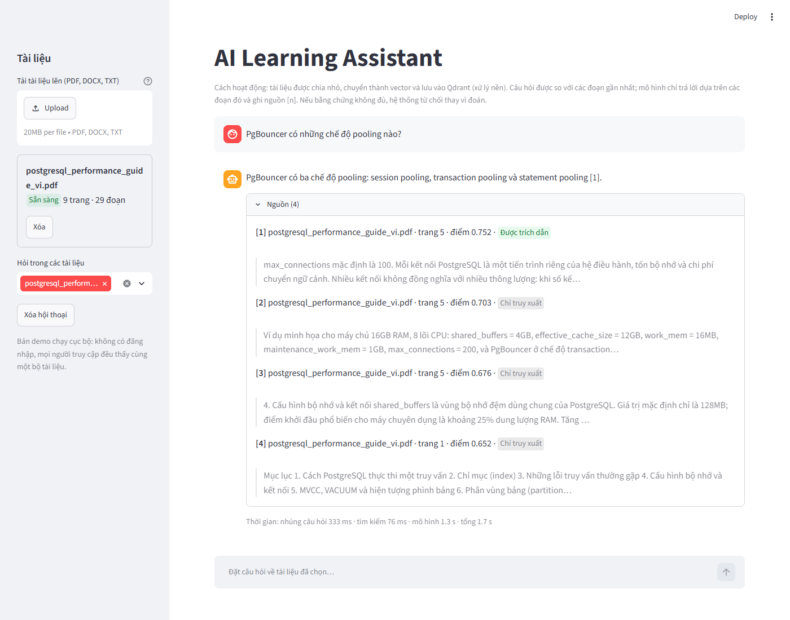
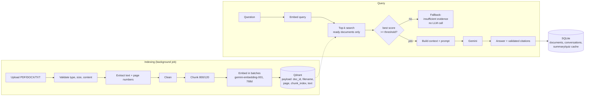
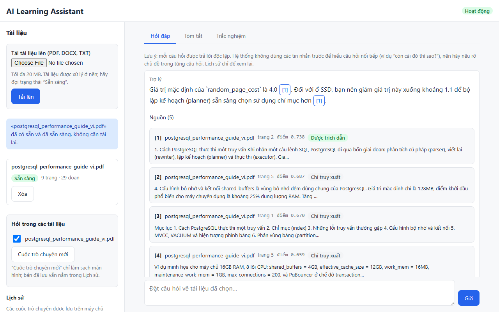
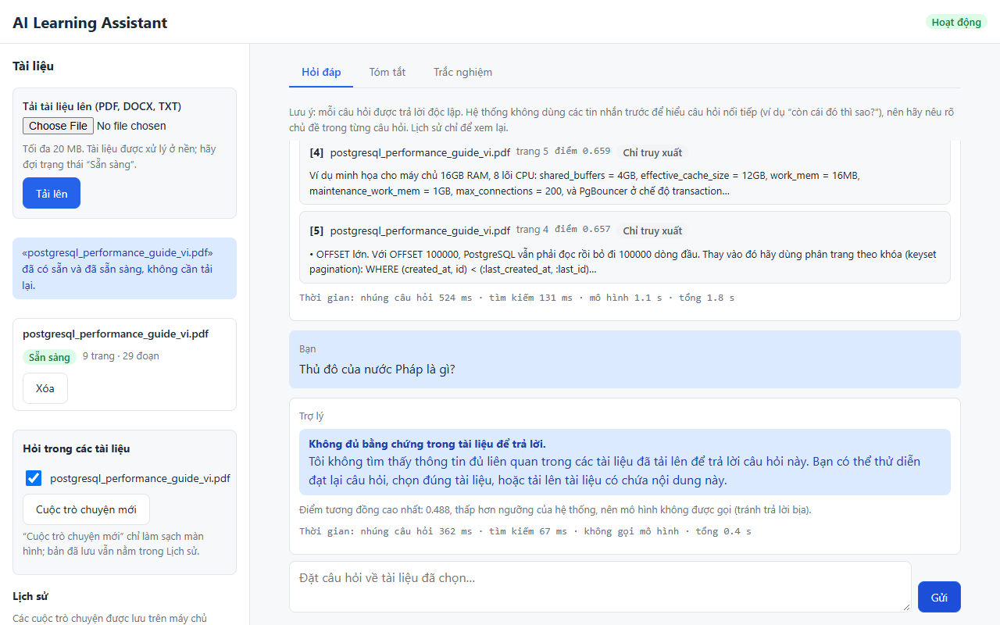
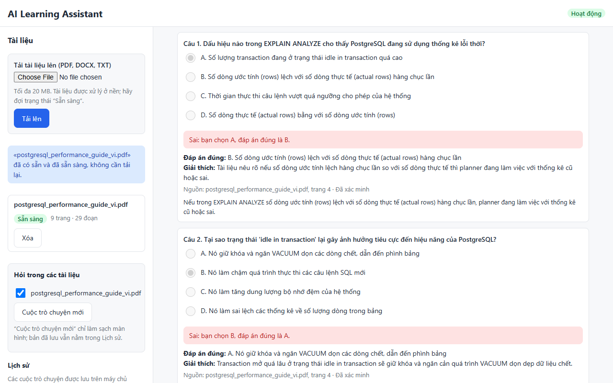
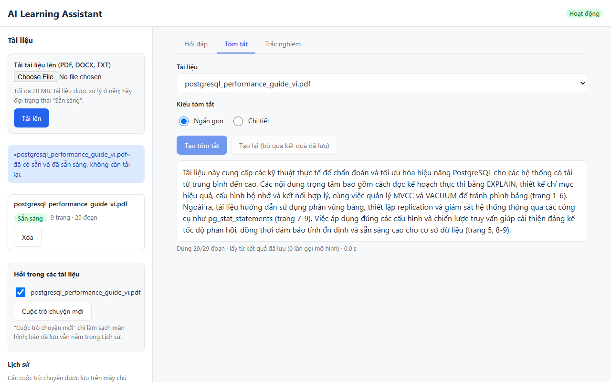
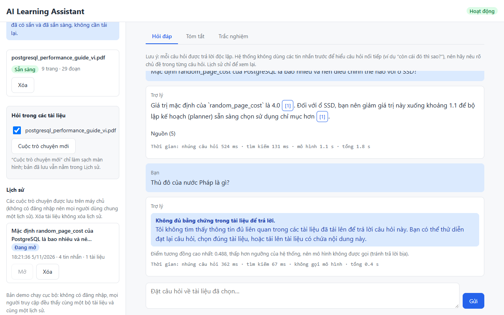
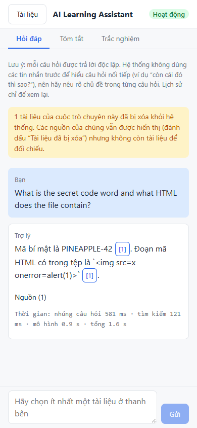

# AI Learning Assistant

A Retrieval-Augmented Generation (RAG) app for studying: upload PDF, DOCX or TXT learning material, ask questions,
and get answers **grounded in your documents with page-level citations**. When the documents do not contain the
answer, it says so instead of guessing. It can also summarise a document and generate a multiple-choice quiz whose
answers are checked against the source text.



## Highlights

- **Grounded answers, honest fallbacks.** If no retrieved chunk passes a similarity threshold, the app answers
  "insufficient evidence" **without calling the LLM**. Otherwise the prompt tells the model to answer only from the
  supplied context and to cite chunks as `[n]`; citation numbers that do not exist are removed in code.
- **Measured, not claimed.** A 20-question evaluation set (single-chunk, multi-chunk, insufficient-evidence and
  unrelated questions) with real results in [`evaluation/report.md`](evaluation/report.md).
- **Hand-written pipeline.** No LangChain chains: every step (extract, clean, chunk, embed, search, filter, prompt,
  cite) is plain Python that can be read and explained. Only `langchain-text-splitters` is used for splitting.
- **Production-minded details:** idempotent indexing (re-uploading the same file never duplicates vectors),
  background indexing with status polling, upload limits enforced before the body is read, retry with backoff on
  rate limits, prompt-injection markers around retrieved text, no secrets in code or logs.
- **Known limitations are documented**, including what was and was not verified: [`docs/known_issues.md`](docs/known_issues.md).

## Evaluation results

One 9-page Vietnamese PDF (29 chunks), 20 questions, run on 2026-11-05. Full method, per-question tables and caveats
are in [`evaluation/report.md`](evaluation/report.md).

| Metric | Result |
|---|---|
| Retrieval Hit@5 / MRR (15 answerable questions) | 1.000 / 1.000 |
| Retrieval Recall@5 / Precision@3 (page-level labels) | 0.978 / 0.778 |
| Answer correctness (LLM judge) | 12/15 correct, 3/15 partially correct, 0 wrong |
| Unanswerable questions handled correctly | 5/5 (2 threshold fallbacks, 3 correct LLM refusals) |
| Faithfulness (no unsupported claim) | 18/18 answers that called the LLM |
| Latency | median 1.6 s, p95 16.0 s, max 62.2 s (free-tier tail) |

**Read these numbers with care:** the set is small and uses one document, labels are page-level, the threshold was
tuned on some of the same questions, and the judge is an LLM (`gemini-3.1-flash-lite`, the same model that answered).
See section 10 of the report and KI-26.

## Architecture



| Layer | Files |
|---|---|
| Configuration (`.env`, typed) | `app/config.py` |
| Ingestion: validation, extraction, cleaning, chunking | `app/ingestion.py` |
| Embeddings (behind an interface, swappable) | `app/embeddings.py` |
| Vector store (Qdrant) | `app/vectorstore.py` |
| RAG pipeline, threshold, citations | `app/rag.py`, `app/prompts.py`, `app/generation.py` |
| Summary and quiz | `app/summary.py`, `app/quiz.py` |
| Metadata, history, generation cache (SQLite, no ORM) | `app/db.py` |
| REST API | `app/main.py` |
| Streamlit UI | `frontend/` |
| Evaluation | `evaluation/` |

### Key design decisions

| Decision | Why |
|---|---|
| Gemini embedding API instead of local BGE-M3 | BGE-M3 is a ~2 GB model and slow on a laptop CPU without a GPU. The API is free-tier, fast and handles Vietnamese. It sits behind an interface, so BGE-M3 can be swapped back in. |
| No LangChain in the core | Fewer moving parts, and every step can be explained. |
| Chunk ID = uuid5(file hash + chunk index) | Re-uploading the same file overwrites instead of duplicating vectors. |
| Threshold fallback before the LLM | Unrelated questions cost no LLM call and cannot be hallucinated. The LLM's own refusal is the second safety net for related-but-absent topics, because the score ranges overlap (KI-17). |
| Indexing as a background job (`202` + polling) | Free-tier embedding throughput is about 100 texts per minute, too slow for a blocking request. |
| SQLite via `sqlite3` | Enough for metadata and chat history in a single-user demo, zero setup. |

## Getting started

Requirements: Python 3.12 (the version this project was developed and tested on; 3.11 has not been tested), Docker (for Qdrant), and a free Gemini API key from
[Google AI Studio](https://aistudio.google.com/apikey).

```powershell
git clone <your-repo-url> ai-learning-assistant
cd ai-learning-assistant

python -m venv .venv
.venv\Scripts\activate            # macOS/Linux: source .venv/bin/activate
pip install -r requirements.txt

copy .env.example .env            # macOS/Linux: cp .env.example .env
```

Fill in `.env`. These are the values used for the evaluation:

```ini
GEMINI_API_KEY=your-key-here
GEMINI_LLM_MODEL=gemini-3.1-flash-lite
GEMINI_EMBEDDING_MODEL=gemini-embedding-001
EMBEDDING_DIM=768
SCORE_THRESHOLD=0.65
LLM_THINKING_LEVEL=minimal
```

Model names change often, so check that they exist for your key. Changing the embedding model or dimension requires
re-indexing (recreate the Qdrant collection).

Start the three parts, each in its own terminal (from the project root, with the venv activated):

```powershell
docker compose up -d                          # 1. Qdrant on http://localhost:6333
uvicorn app.main:app --reload                 # 2. API on http://127.0.0.1:8000 (docs at /docs)
streamlit run frontend/streamlit_app.py       # 3. Streamlit UI on http://127.0.0.1:8501 (optional)
```

### Web UI (`/ui`)

Besides Streamlit, the API serves a plain HTML/CSS/JS interface (no build step, no Node) from `web/`. Once the API is running, open
**<http://127.0.0.1:8000/ui/>**. It offers the same flows as the Streamlit app (documents, chat with citations, summary, quiz, history) and
adapts to phone widths. Answers are shown as plain text (no Markdown rendering). The design spec is in
[`docs/web_ui_design.md`](docs/web_ui_design.md).

### Run the API with Docker

`docker compose up -d --build` starts Qdrant **and** the API container (port 8000, with `/ui/`); `.env` supplies the Gemini key and
model names, and `./data` is mounted for uploads and SQLite. Use it instead of the `uvicorn` line above (both listen on port 8000). After
changing `web/` or `app/`, rebuild with `docker compose up -d --build api`.

Try it with the sample document `data/samples/postgresql_performance_guide_vi.pdf`.

## API

| Method | Path | Purpose |
|---|---|---|
| GET | `/health` | Liveness and dependency status |
| POST | `/documents` | Upload a file; returns `202` and indexes in the background (`200` if the same file is already `ready`) |
| GET | `/documents`, `/documents/{doc_id}` | List documents / poll status (`processing` → `ready` or `failed`) |
| DELETE | `/documents/{doc_id}` | Delete vectors, metadata and the stored file |
| POST | `/chat` | Ask a question; answer + sources, saved to history |
| GET | `/conversations`, `/conversations/{id}` | List saved conversations / open one (no LLM call) |
| DELETE | `/conversations/{id}` | Delete a saved conversation |
| POST | `/documents/{doc_id}/summary` | Short or detailed summary (cached) |
| POST | `/documents/{doc_id}/quiz` | Multiple-choice quiz with answer key, explanations and source quotes (cached) |

Interactive documentation: <http://127.0.0.1:8000/docs>.

## Tests and evaluation

```powershell
pytest -q                                     # unit, API and UI tests (Gemini and Qdrant are faked)
python evaluation/evaluate.py --report-only   # rebuild evaluation/report.md from cached results
python evaluation/evaluate.py                 # re-run; real API calls are cached in evaluation/cache/
```

## Screenshots

Web UI (`/ui/`):

| Answer with sources | Insufficient evidence | Quiz results |
|---|---|---|
|  |  |  |

| Summary | Saved conversation | Phone (390 px) |
|---|---|---|
|  |  |  |

Streamlit app: [`fallback-case.png`](docs/screenshots/fallback-case.png), [`12-quiz-results.png`](docs/screenshots/12-quiz-results.png),
[`15-history-saved.png`](docs/screenshots/15-history-saved.png). All images are in [`docs/screenshots/`](docs/screenshots/).

## Limitations

The most important ones (the full list, with evidence, is in [`docs/known_issues.md`](docs/known_issues.md)):

- **No authentication**: all documents and conversations are shared by everyone who can reach the API. Local demo only.
- **No OCR**: scanned PDFs are rejected. DOCX and TXT have no page numbers in citations.
- **One threshold cannot separate everything**: related-but-absent questions can pass it, and the LLM's refusal then
  handles them (KI-17).
- **Citation checks are shallow**: the code verifies that a cited chunk exists, not that it supports the sentence (KI-20).
- **Follow-up questions do not use earlier messages**: history is saved, not used as context (KI-29).
- **Web UI**: answers are plain text (no Markdown); checked in one browser (Edge) with a read-only code review and an XSS test, not with automated browser tests (KI-30).
- **Free-tier limits**: daily LLM quota, occasional 500/503/504 errors and slow responses (KI-18).

## Possible improvements

Hybrid search (BM25 + vectors) and a reranker for related-but-absent questions; chunk-level evaluation labels and a
separate dev/test split; structure-aware chunking (keep headings with their body, drop repeated headers and footers);
authentication with per-user collections; a real task queue for indexing; automated browser tests for the web UI; a Docker image for the Streamlit UI.
